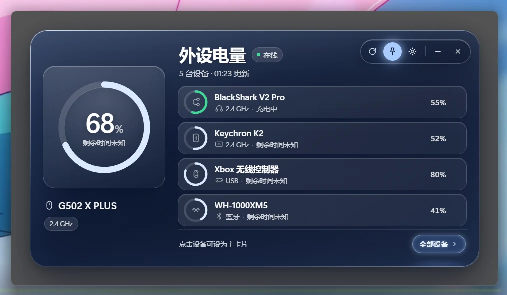
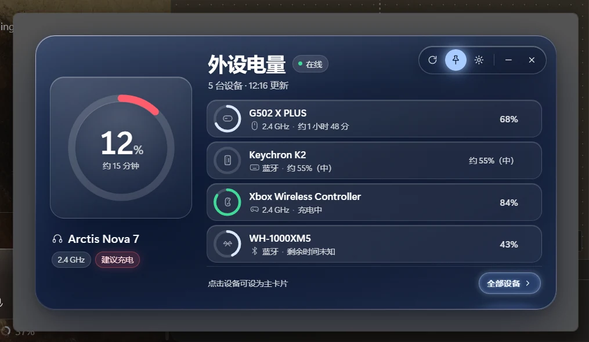
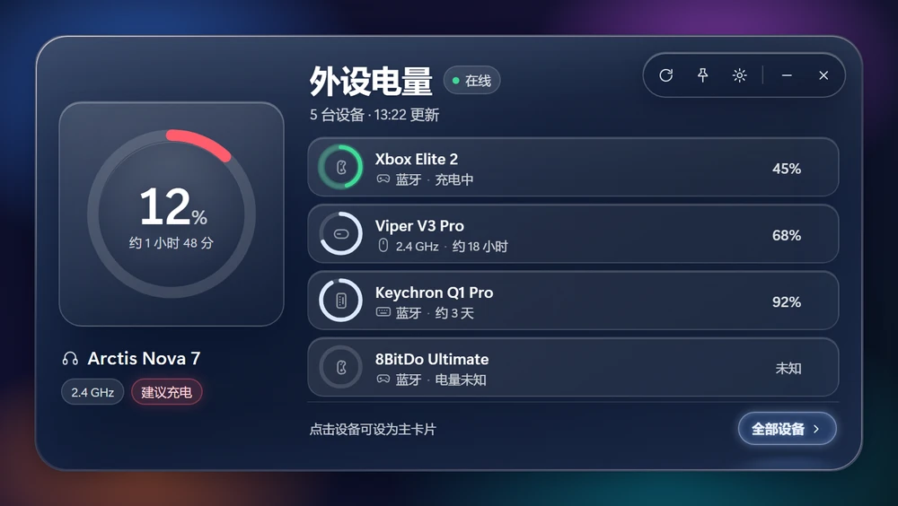

# 外设电量显示器（Peripheral Battery）

**[下载安装包](https://github.com/wh23423/PeripheralBattery/releases/latest)** · MIT License

> 当前版本 **v0.1.1**（评审 A1–A14 修复版，见 §6 与 [Release Notes](docs/release-notes-v0.1.1.md)）。

Windows 托盘常驻的外设电量面板：鼠标 / 键盘 / 耳机 / 手柄，覆盖 2.4G 接收器、USB、蓝牙三条链路。
外观为液态玻璃浮动面板（720×380 DIP 窗口 = 面板尺寸 / 12px 圆角，acrylic 只铺满面板）。

## 系统要求

| 项 | 要求 |
|---|---|
| 系统 | Windows 10 1809（build 17763）+ / Windows 11，**x64** |
| WebView2 | Microsoft Edge WebView2 Runtime **118.0.0.0+**（安装器内置引导程序；启动时再次预检，缺失/过旧会弹中文可操作提示而不会“双击没反应”） |
| 磁盘 | 安装约 120 MB（WebView2 Runtime 另计） |
| 权限 | 默认当前用户安装（`%LOCALAPPDATA%\PeripheralBattery`），**无需管理员**；静默部署见 §4「发布」 |

> 施工依据：[BUILD_PLAN.md](BUILD_PLAN.md)（构建方案 v1.1，含 18 条对抗性审查处置）、[TECH_PLAN.md](TECH_PLAN.md)（架构与视觉规范）、[protocol.md](protocol.md)（三方通信协议，施工后定稿）。

## 预览







> 安装包见 GitHub Releases；`design/` 下的完整验收证据与录屏不随源码仓库分发。

---

## 1. 架构

```
collector.exe (Python, stdio NDJSON)  ⇄  app.exe (Tauri 2 / Rust)  ⇄  WebView2 (ui/)
   31 个厂商 provider、稳定 key、            窗口/托盘/Job Object/隐藏四步/      静态页：keyed diff、
   完整快照门控、last_seen gone              事件转发/命令转发                   液态玻璃、动效
```

- 采集与 UI 分进程：HID 独占、崩溃隔离、技术栈自由（TECH_PLAN D1）。
- 协议见 [protocol.md](protocol.md)：`hello/device/gone/tick/alert/stat` + `hello.session/seq`；
  设备 key 为 `provider:vid:pid:(serial|mac|unit_id|uN)`，`aliases.json` 持久化，迁移发 `replaces`。
- 隐藏时四件事都做：`put_IsVisible(FALSE)` → 暂停 WAAPI/rAF → 不写 DOM → `window.hide()`；
  显示反向执行并先用最后快照渲染一帧。
- 支持范围（`make_providers()` 注册的 31 个 provider）：雷蛇、罗技、赛睿、HyperX、海盗船、
  华硕 ROG/TUF、Audeze、Astro、JBL、Keychron、Pulsar/ATK、WLmouse、LAMZU、
  LunaFury（Luna33-W，`373E:0033` 无线，真机验证电量与充电状态）、MCHOSE、G-Wolves、NZXT、洛斐、怒喵、索尼、任天堂、8BitDo、Valve、Xbox 兼容手柄，
  外加 Windows 蓝牙通用兜底（任何系统能报电量的 BLE HID）。型号与协议明细见上游
  [hb/docs/devices.md](hb/docs/devices.md)、[hb/docs/protocols.md](hb/docs/protocols.md)。

## 2. 目录

| 路径 | 说明 |
|---|---|
| `collector/` | Python 采集器（`providers/` 原样复制自 HaloBattery；`state.py`/`keys.py`/`collector.py`/`transport.py`/`fake.py`） |
| `collector_entry.py` | PyInstaller 入口（包内相对导入，不能直接打包 `collector/__main__.py`） |
| `src-tauri/` | Tauri 2 外壳（窗口、托盘、sidecar、Job Object、单实例、IsVisible、命令/事件） |
| `src-tauri/nsis/` | NSIS 安装/卸载钩子 `installer-hooks.nsh`（卸载清注册表 / WebView2 profile / 数据目录 / `RMDir /r $INSTDIR`） |
| `ui/` | 静态前端（`bridge.js` IPC 桥、`app.js` keyed diff、`styles.css` 液态玻璃 + 性能改造） |
| `tests/collector/` | 采集器 pytest（v0.1.1：117 项） |
| `tools/` | 截图/录屏/性能/验收脚本（`ui_smoke.js`、`verify_runtime.py`、`verify_fps.js`、`collector_demo.ps1`） |
| `scripts/` | `build-collector.ps1`、`build.ps1`（签名 + SHA256SUMS/build-info）、`sign.ps1`、`verify-uninstall.ps1`、`dev.ps1`、`verify-*.ps1` |
| `design/` | 设计稿、演示素材、`design/verify/` 验收证据 |
| `dist/collector/` | PyInstaller onedir 产物（打包时映射到安装目录 `collector/`） |
| `hb/` | 上游 HaloBattery 参考克隆，**不要改** |

## 3. 环境准备

| 依赖 | 本机路径 / 版本 |
|---|---|
| Python | `C:\Users\28482\AppData\Local\Programs\Python\Python312\python.exe`（3.12.9；PATH 里没有） |
| Rust | `%USERPROFILE%\.cargo\bin`（rustc/cargo 1.99.1，stable-x86_64-pc-windows-msvc） |
| Node / npm | 24.20.0 / 11.19.0 |
| WebView2 | 155.x（应用最低要求 **118+**） |
| VS2022 | MSVC 14.44 + Windows SDK 10.0.26100 |

```powershell
# 一次性
& "$env:LOCALAPPDATA\Programs\Python\Python312\python.exe" -m venv .venv
.\.venv\Scripts\python.exe -m pip install -r collector\requirements.txt -r requirements-dev.txt
npm install
```

## 4. 开发 / 构建 / 测试

```powershell
# 开发（默认显示面板；-NoShow 只驻留托盘）
.\scripts\dev.ps1
.\scripts\dev.ps1 -Collector '"D:\...\.venv\Scripts\python.exe" -m collector --stdio --fake --scenario static'

# 只跑 Tauri（debug 可执行文件已构建时）
$env:PB_SHOW_ON_START="1"; .\src-tauri\target\debug\peripheral-battery.exe

# 构建 collector + Tauri + NSIS 安装包
.\scripts\build.ps1
.\scripts\build.ps1 -Debug -NoBundle      # 只编译 debug exe，不做安装包

# 测试
.\.venv\Scripts\python.exe -m pytest tests\collector -q
node tools\ui_smoke.js
node tools\ui_shots.js                    # 评审截图 -> design/verify/ui-*.png
powershell -File tools\collector_demo.ps1 # collector 端到端 demo（probe/stdio/--once）
```

### 发布：签名 / 校验和 / 部署参数

`scripts\build.ps1` 构建完成后会在安装包同目录（`src-tauri\target\release\bundle\nsis\`）生成：

- `SHA256SUMS.txt`：setup.exe / app.exe / collector.exe 的 SHA-256
- `build-info.json`：版本、git commit（含 dirty 标记）、构建时间、每个产物哈希、`signed` 状态

代码签名（**签名需要证书**；本仓库不包含证书，未配置时发布包为 NotSigned）：

```powershell
# 方式 A：证书指纹（证书须在 Cert:\CurrentUser\My 或 LocalMachine\My）
$env:PB_SIGN_THUMBPRINT = "<sha1 thumbprint>"
.\scripts\build.ps1

# 方式 B：PFX + 密码
$env:PB_SIGN_CERT_PATH = "D:\certs\peripheralbattery.pfx"
$env:PB_SIGN_CERT_PASSWORD = "<password>"
$env:PB_SIGN_TIMESTAMP_URL = "http://timestamp.digicert.com"   # 可选，默认即此
.\scripts\build.ps1

# 本地快速验证：即使配置了证书也跳过签名
.\scripts\build.ps1 -NoSign
```

说明：当前是“构建后签名”——setup.exe / app.exe / collector.exe 文件本身会签名并校验 Valid；
安装包内打包的 app/collector 副本仍是构建时未签名版本。需要整链签名时，应把签名接入 Tauri
`bundle.windows.signCommand`（证书就绪后再做）并重新构建安装包。配置了证书但签名失败时
`build.ps1` 会终止（不会“以为签了其实没签”）。`PB_BUILD_SHA` / `PB_BUILD` 环境变量可注入
构建号（无 `.git` 的 CI / 源码包场景），release 日志中的 `build=<sha>` 因此不再恒为 `unknown`。

#### 静默安装 / 卸载参数（NSIS）

| 参数 | 说明 |
|---|---|
| `setup.exe /S` | 静默安装（默认安装到 `%LOCALAPPDATA%\PeripheralBattery`） |
| `/D=<路径>` | 自定义安装目录；**必须是最后一个参数且不加引号** |
| `/NS` | 不创建快捷方式（静默安装默认会创建桌面快捷方式） |
| `/R` / `/ARGS=<args>` | 安装完成后运行应用 / 给应用传参 |
| `/P` | 被动模式（显示进度，不显示选项页） |
| `/UPDATE` | 更新模式（保留数据/快捷方式；供后续 updater 调用） |
| `uninstall.exe /S` | 静默卸载：删安装目录/注册表/WebView2 profile，**保留** `%APPDATA%\PeripheralBattery` |
| `uninstall.exe /S /DELETEAPPDATA` | 静默卸载并删除用户数据目录 |

安装器同时编入 English + 简体中文（跟随系统语言）。卸载行为：

| 操作 | 安装目录 | `%APPDATA%\PeripheralBattery` | WebView2 profile | HKCU 注册表 |
|---|---|---|---|---|
| 卸载不勾选“删除应用数据” / `uninstall /S` | 删除 | **保留** | 删除 | 删除 |
| 勾选“删除应用数据” / `uninstall /S /DELETEAPPDATA` | 删除 | 删除 | 删除 | 删除 |
| 覆盖安装 / `/UPDATE` | 保留 | 保留 | 保留 | 保留 |

验收脚本（Optional）：`pwsh -File scripts\verify-uninstall.ps1`。默认静默安装到 `%TEMP%` 下的自定义目录，
不碰默认安装路径；默认只验证“保留用户数据”路径，`-DeleteAppData -ConfirmDeleteAppData` 才测试数据删除。
真实默认路径的安装/卸载由 maintainer 最终复验（脚本会先检查已有安装并拒绝，除非 `-Force`）。

采集器单独使用：

```powershell
.\.venv\Scripts\python.exe -m collector --probe                    # 真实设备，人读
.\.venv\Scripts\python.exe -m collector --probe --fake --scenario demo
.\.venv\Scripts\python.exe -m collector --stdio                    # 生产模式（app 会这样拉）
.\.venv\Scripts\python.exe -m collector --once                     # 一次快照 NDJSON
```

`--fake` 场景：`demo`（5 种 kind + null/approx/charging/replaces/gone/低电告警）、`static`、`migration`。
注意 `--speed` 会同时加速虚拟时钟，>1 时 TTL 会按虚拟秒到期导致设备抖动，演示 UI 请用 `--speed 1`。

## 5. 基线验收与实测（v0.1.0，2026-10-19，本机 Windows 11 build 26300 / 2560×1440 / 125% / 250Hz）

| 指标 | 目标 | 实测（最终 release，2026-10-19 12:20 复测） | 结论 |
|---|---|---|---|
| P1 帧率 | 58–60fps，p99 ≤ 20ms | 显示器 250Hz：rAF **250fps**，p99 **4.2ms**，max 5.8ms，panel 720×380，`backdrop-filter: none`（`lead-hero-fps.png` / app.log `FPS_PROBE`） | 达标（以 250Hz 刷新率为准） |
| P2 隐藏进程树 CPU | < 0.5% | 5 分钟：app 0 + WebView2 0.021 + collector/PowerShell 0.297 = **0.318%**（`lead-hidden-final5.json`） | **达标**（蓝牙 watcher 轮询 2s→30s 后；旧基线 0.666%） |
| P3 采集器 CPU | < 0.8% | 同上 collector + PowerShell = **0.297%**；独立 60s 采样 PowerShell 0.078–0.130% | 达标 |
| P4 进程树内存 | < 320MB | 隐藏稳态 **247.7MB**（WebView2 suspend 后 ~48MB，PowerShell 125.5MB，collector 28.7MB，app 30.4MB）；启动前 ~20s 未 suspend 时峰值 449.3MB | 稳态达标；启动峰值超标（见 §7） |
| P5 冷启动到托盘可用 | < 1.5s | app start → `setup complete` **194–232ms** | 达标 |
| P6 托盘点击到首帧 | < 200ms | 托盘点击日志 → `window shown` **17ms**（`IsVisible(true) S_OK` 后 3ms；内容隐藏时已预渲染） | 近似达标（未取真实 first-paint） |
| P7 24h 内存增长 | < 15MB | 未跑 24h；隐藏 5 分钟 226.4→247.7MB（+21.3MB，主要是 PowerShell watcher），趋势不乐观 | 未完成，有风险 |
| P8 定时器唤醒 | ≤ 1 次/秒 | app.log `collector stat: timers_per_s=0.99`（F7 已可直接从日志复核） | 达标 |
| P9 key 抖动 | 24h < 2 次 | 修复 slot/unit/interface 迁移与 `replaces`；migration/重枚举场景无抖动；24h 未跑 | 部分达标 |
| P10 更新/退出孤儿 | 0 | 正常退出、卸载、强制 kill、shutdown 超时 `TerminateJobObject` 均无 app/collector/PowerShell 残留 | 达标 |

其它已验证：`cargo check` 0 warning、`cargo test` 10 passed、pytest **94 passed**、`ui_smoke` **15 passed**；
PyInstaller onedir collector 独立运行；NSIS 安装包（**8.92 MiB**，13:12 重建）安装 → 从安装目录 `resource_dir()\collector\collector.exe` 启动 → hello → 正常退出 → 卸载后目录/进程/快捷方式全清；
单实例互斥体（第二实例 ~10ms 退出并激活已有面板）；托盘真实左键点击、状态色图标；失焦 270ms 隐藏（pinned 抑制）；
隐藏时 `IsVisible(false)=S_OK` + `TrySuspend`；隐藏态托盘由 Rust 镜像持续更新（不受 WebView 冻结影响），恢复时自动 `get snapshot` 补数据；
最小化走隐藏四步且可恢复；协议版本不符/启动失败/5s 无 hello 的错误态均不崩。

### 修复后复测（2026-10-19 12:15–13:22，最终 NSIS 包 13:12）

| 项 | 结果 | 证据 |
|---|---|---|
| **P0 可见启动死锁** | **PASS**：`tray update` 改主线程非持锁调用后，tauri-dev 压测可见 **40/40** + 隐藏 10/10，Lead 独立 20/20 可见启动，0 hang、全部有 `app exit`；`tray-update begin/end=1320/1320` | `design/verify/stress-visible.json`、`design/verify/tray-stress-result.json` |
| F1 主卡 = 最低电量（逐条 device 到达） | **PASS**：真实 app + 逐条 mock 数据，主卡 Arctis 12%，列表 G502 68 / Keychron 55 / Xbox 84 / XM5 43 | `design/verify/lead-hero-fps.png` |
| F3 纯蓝牙冷启动首出数 | **PASS**：collector-dev 10/10 **1.33–1.45s**；Lead 独立 5/5 **1.53–1.71s**（修复前 2/4 次 65–128s） | app.log；首快照 +3/+8/+15/+30s 补采（roots-only 门控） |
| F4 ui_ready 兜底误判 | **PASS**：ui_ready → 失焦 1.06s 隐藏后，无 `ui_ready not received` WARN、无 fallback re-show，正常退出 | 本次复测日志 |
| F7 stat 可观测性 | **PASS**：app.log 每 60s 输出 `collector stat: timers_per_s=0.99 key_migrations=0 providers=30 slowest=mchose:2.0ms` | app.log |
| 最终 NSIS 包 | **PASS**：8.92 MiB；安装后 collector.exe + `_internal\python312.dll`；安装版从安装目录 packaged 启动 + hello ready；退出 Job active=0；卸载后目录/进程全清 | `%TEMP%\PB-install-test3` 测试记录 |

### 审计发现并已修复的运行问题

| # | 问题 | 修复 |
|---|---|---|
| 1 | 最小化后 `show()` 不清 MINIMIZED，`skipTaskbar` 又无任务栏入口 → 面板永久打不开 | minimize 改完整隐藏四步；show 前 `unminimize`；定位用固定 780×440 |
| 2 | 隐藏态托盘启动即「离线」且永不更新；`TrySuspend` 后前端 JS 冻结 | Rust 侧 `tray_mirror` 直接解析 sidecar 事件更新托盘；恢复时自动 `get snapshot` |
| 3 | 托盘「设置」隐藏态无效果 | 先 `show_panel` 再 emit `tray-action` |
| 4 | shutdown 超时只 TerminateProcess collector → PowerShell 孤儿 | `TerminateJobObject` 清整棵进程树 |
| 5 | `\\?\` 前缀导致 packaged collector 残留清理失效 | normalize 剥 verbatim/UNC 前缀 |
| 6 | 隐藏态 WebView2 内存 300MB+ | `TrySuspendAsync` + `MemoryUsageTargetLevel=LOW`，隐藏稳态降至 258MB |
| 7 | Rust 与 collector 抢写 `config.json` | Rust 改用 `app.json`，旧 pinned 一次性迁移，不碰 collector 字段 |
| 8 | 真实设备 slot/unit/interface 变化重新分配 key（P9 抖动） | 同轮唯一 fingerprint 复用 ordinal + `replaces` + 迁移 names/hidden |
| 9 | 单 provider 挂死永久 in-flight；refresh 在轮中丢弃；退出 6.1s + PowerShell 孤儿；`--once` 无蓝牙 | 超时熔断/空槽调度；refresh 延迟重投；daemon + 子进程 registry/Job；等待 BT 首快照 |
| 10 | 蓝牙 watcher 失败后 2s 兜底轮询；常驻 PowerShell 占 P2/P3 预算 | 兜底改为 60s 限频 one-shot；WATCH_SCRIPT 轮询 2s→10s（collector 层 patch，不改上游文件），P2 0.666%→0.386% |
| 11 | 纯蓝牙冷启动首出数间歇 65–128s（首次快照漏设备） | 首快照缺当前可显示设备时 +3/+8/+15/+30s 补采（roots-only 门控）；复测 10/10 1.33–1.45s |
| 12 | 主卡锁定首个到达设备而非最低电量 | 自动模式每次取最低电量，仅用户点击固定；真实 app 复测主卡 12% |
| 13 | **P0：可见启动主线程死锁（9/39≈23%）**：`update_tray_icon` 持 `state.tray` 锁调 `set_icon`，侧车 `tray_mirror` 与主线程 `set_tray_state` 并发互等 | tray API 一律 `run_on_main_thread` 且不持锁调用（clone 句柄后释放锁）；DPI scale 缓存到 AppState；压测可见 40/40 + Lead 独立 20/20 可见启动 0 hang，begin/end 1320/1320 |
| 14 | 蓝牙 watcher 10s 间隔时 P2 5min 波动 0.386–0.662% | 默认间隔再降到 30s；PS CPU 0.078–0.130%（旧 2s 基线 0.547%），P2 5min 复测见 §5 |

审计报告：[design/audit/shell-audit.md](design/audit/shell-audit.md)、[design/audit/collector-audit-independent.md](design/audit/collector-audit-independent.md)、[design/audit/collector-audit.md](design/audit/collector-audit.md)（修复记录）、[design/audit/runtime-audit.md](design/audit/runtime-audit.md)（运行审计）、[design/audit/final-runtime-audit.md](design/audit/final-runtime-audit.md)（最终独立复验，发现 P0 死锁并已修复）。

## 6. v0.1.1 修复与发布（2026-10-19 晚，评审 A1–A14）

评审报告 [review/REVIEW-REPORT.md](review/REVIEW-REPORT.md) 的 14 项 P1 修复版；版本号 0.1.1
（`tauri.conf.json` / `Cargo.toml` / `package.json` 一致），Release Notes 见
[docs/release-notes-v0.1.1.md](docs/release-notes-v0.1.1.md)。

> v0.1.1 回归：`cargo test` **55 passed**、collector pytest **117 passed**、`ui_smoke` **21 passed**（Lead 复核）；
> 运行验收清单由 Lead 记录在 `review/FIX-VERIFICATION.md`。最终 NSIS 安装/卸载验收由 Lead 在默认路径执行。

| # | 问题（评审） | v0.1.1 修复 | 本轮验证 |
|---|---|---|---|
| A1 | P1-01 安装目录=数据目录：卸载残留、删错数据 | 数据迁 `%APPDATA%\PeripheralBattery`（`PB_DATA_DIR` 可覆盖并下发 sidecar）；`paths.rs` 首启迁移 0.1.0 旧数据（只补缺失、写 marker）；NSIS hooks 卸载无条件清 `HKCU\Software\peripheralbattery\PeripheralBattery`、WebView2 profile、守卫式 `RMDir /r $INSTDIR`；勾选或 `/DELETEAPPDATA` 才删真实数据 | **默认路径实机验收通过**：`/S` 安装→首启迁移 `copied=6 marker=written`→`/S` 卸载（INSTDIR/注册表/profile 清、数据保留）→重装→`/S /DELETEAPPDATA`（数据/目录/注册表清）（[FIX-VERIFICATION §4.1](review/FIX-VERIFICATION.md)） |
| A2 | P1-02 WebView2 仅在线 bootstrapper、无最低版本/运行期检测 | 安装器改 `embedBootstrapper` + `minimumWebview2Version=118.0.0.0`；`webview2_check.rs` 启动前 `GetAvailableCoreWebView2BrowserVersionString` 预检，缺失/过旧弹中文 MessageBoxW 并退出；README 补系统要求 | 启动日志实测 `webview2 runtime version=155.0.4283.62`（≥118）；版本比较/提示文案 5 单测；真实“缺 WebView2 / 旧版”提示需干净环境复验 |
| A3 | P1-03 未签名、无发布者元数据、无校验和 | tauri.conf 填 publisher（`peripheralbattery`，与 0.1.0 注册表键一致）/copyright/license/licenseFile/short+longDescription/homepage/category；安装器加许可页 + English/SimpChinese；`LICENSE`/`THIRD_PARTY_NOTICES.md` 随包装到 `licenses\`；`build.ps1` 生成 `SHA256SUMS.txt`+`build-info.json` 并调用 `sign.ps1`（有证书才签，否则 `signed:false`）；`build.rs` 监听 `.git` 并注入 `APP_BUILD`/`PB_BUILD` | 最终 NSIS 构建 exit 0（setup sha256 `7e1832b9…f4feded`），release exe 实测 0.1.1 版本/公司/版权元数据、`build=5d096f5`；无证书路径 `signed:false`；签名 `Valid` 需证书复验 |
| A4 | P1-04 系统最小化后第一次点托盘无效 | 状态以 `IsWindowVisible + !IsIconic` 校准；最小化走完整隐藏四步；恢复时无条件 unminimize+set_size | **实机通过**：`SW_MINIMIZE`→隐藏四步/IsVisible(false)→一次激活显示→恢复尺寸 900×475@125%（同时修复 199×34 回归） |
| A5 | P1-05 `Global\` 互斥体跨会话失效/双实例 | 改 `Local\` 会话级命名；权限冲突时中文提示 | **实机通过**：同会话第二实例 <5s 退出并激活已有面板、仅 1 个 app 进程；不同实例名/数据目录可并行（测试隔离前提）；RDP/快速用户切换待验 |
| A6 | P1-06 `cleanup_residual` 误杀另一实例的 collector | pid 记录绑定 app_pid/instance/data_dir/exe，归属校验后才 kill | **实机通过**：无关进程 pid 记录不误杀（`exe mismatch` 只删文件）；另一活实例 collector 不误杀（`skip kill`）；11 归属判定单测 |
| A7 | P1-07 虚拟桌面下看不到面板 | `GetWindowDesktopId(前台窗口)` 启发式 + `MoveWindowToDesktop`，失败仅 WARN 不阻塞；`PB_DISABLE_VD=1` | **实机通过（Win+Ctrl+D 临时桌面，测后关闭）**：普通窗口 cloaked=2 对照、面板 cloaked=0 在桌面 2 可见、日志 `moved-to-current`；本机该窗口为“所有桌面可见”，P1-07 症状不可复现；单桌面分配环境走前台启发式 |
| A8 | P1-08 拖拽区仅 6px 缝隙可拖 | `data-tauri-drag-region="deep"` 覆盖标题/空白 header | **实机通过**：真实鼠标在标题区拖动 90px 窗口移动成功；ui_smoke 断言拖拽子树/按钮可点 |
| A9 | P1-09 生产面板弹 WebView2 右键菜单、F5 重载 | WebView2 层关闭默认右键菜单/浏览器加速键 + document 级 contextmenu/加速键兜底拦截 | **实机通过**：F5 不重载/不重置窗口、右键无浏览器菜单、hardening 日志；ui_smoke 21 项覆盖 |
| A10 | P1-10 睡眠唤醒 gone 风暴 | 时钟跳变检测：恢复轮跳过 expire 并刷新 last_seen；stats 增 clock_jumps | +4 注入时钟单测（117 passed）；真实睡眠/唤醒待人工验证 |
| A11 | P1-11 蓝牙 30s watcher 吞掉 +3/+8/+15s 补采 | watcher 改按最早 due 时间调度（连接检查仍按 bt_watch_ms） | **真实 PowerShell 实测**：快照偏移 0/+4.1/+9.0/+16.1/+31.0s；+10 调度单测 |
| A12 | P1-12 隐藏态托盘 pin 事件丢失/迟到 | Rust 侧直接 `set_pinned` + 同步菜单勾选 + emit app-state | **实机通过**：隐藏态（WebView 已 suspend）pin 立即落盘、只发生一次、显示后无迟到 toggle |
| A13 | P1-13 collector 崩溃后托盘冻结 | 立即发布 offline 托盘；按存活时长重置预算的指数退避 1/3/10s（≤5 次），用尽保留手动重启 | **实机通过**：崩溃后 <2s 离线；attempt=1/2/3 且 delay=1000/3000/10000；第 4 次 spawn 恢复；hello 不再清零预算 |
| A14 | §10 展开后四周灰框 / acrylic 不可用 | 采用评审报告 **备选 B**：窗口尺寸 = 面板尺寸 720×380（去掉 30px 安全边），acrylic 只铺满面板；透明效果关闭/远程/虚拟显示时 acrylic 降级为 CSS 烟熏底并下发 `acrylic:false`。原方案 A（`SetWindowRgn` 区域裁剪 + acrylic）经 4 组变体实拍确认会被 DWM 降级成纯灰 `#545454`，故弃用 | **实机通过（16/16）**：窗口 900×475=720×380@125%、无 SetWindowRgn、backdrop=3（真 acrylic）、面板外无均匀灰带（仅 DWM 柔和阴影）、贴托盘 clamp 正确、`PB_DISABLE_ACRYLIC=1` 降级路径通过；截图 `design/verify/region-after*.png` |

> 说明：表中「本轮验证」只列**实际跑过**的检查。v0.1.1 的完整运行验收（`tools/verify_phase_a.py all` **52/52**、
> A7 双桌面 9/9、默认路径安装/卸载、20+5 启动压测 0 hang）由 Lead 执行，证据与未验证项见
> [review/FIX-VERIFICATION.md](review/FIX-VERIFICATION.md)。v0.1.0 基线数据仍见 §5（历史，保留对照）。

## 7. 已知限制 / 未验证

- **P7 风险**：隐藏 5 分钟 RSS 226.4→247.7MB（+21.3MB，主要来自常驻 PowerShell watcher）；24h 常驻/每小时采样未跑，不能判定 P7 达标。
- **P4 启动峰值**：隐藏后前 ~20s（TrySuspend 生效前）进程树峰值 449.3MB，超过 320MB；稳态 247.7MB 达标。若指标按“任意时刻”统计则不达标。
- **蓝牙连接检测延迟**：常驻 PowerShell watcher 轮询已从上游 2s 降到 **30s**（P2 0.318%），代价是“设备连接/断开”最多延迟 30s 才反映到托盘；初始快照与连接后的 +3/+8/+15s 快照不受影响。可用 `PB_BT_WATCH_MS` / `config.json:bt_watch_ms` 调回更灵敏的值（2s 时 P2 会回到 0.6%+）。彻底方案仍是 §3.4 的 `CfgMgr32 CM_Get_DevNode_PropertyW` 直读 + WGI 常驻 helper。
- **P6 非精确**：未从真实托盘点击打点到 first-paint，仅有 click→shown 17ms + 预渲染证据。
- **真实设备适配**：本机仅一台可读蓝牙设备（FlyDigi BS2 PRO）；30 个 provider 的 serial/mac/unit 解析、WGI 路径、P9 24h 未真机验证。
- **电源事件**：suspend/resume 的 `new_session` 协议已备好，未接 `WM_POWERBROADCAST`；offline 告警未实现。
- **托盘右键菜单**：已用 debug-only 同分支钩子验证；原生菜单真实鼠标点击因桌面被全屏播放器占用未自动化。
- **Win10 / 多屏 / 100%/150%/200% DPI / 三张壁纸对比度**：未实测；Win10 仅有代码路径与模拟。
- **打包/更新（v0.1.1）**：安装/数据目录已拆分，卸载清注册表/WebView2 profile/安装目录，`/DELETEAPPDATA` 与“删除应用数据”可控；WebView2 用 `embedBootstrapper` 并做运行期预检；`build` 号可回溯 commit。**自动更新（updater）仍未接线**，只能手动下载安装包升级。
- **签名需证书**：`scripts/build.ps1` 支持 Authenticode，但仓库不含证书；未配置 `PB_SIGN_*` 时发布包为 NotSigned（以 `SHA256SUMS.txt` 校验）。且当前是构建后签名——安装包内 app/collector 副本仍是构建时未签名版本，整链签名需接 `bundle.windows.signCommand`。
- **WebView2 离线**：`embedBootstrapper` 只在“系统没有 WebView2”时运行内置引导程序，而引导程序本身仍需联网向 Microsoft 下载/安装 Runtime；完全离线/内网机器请预装 WebView2 Runtime（≥118）或改用 offlineInstaller 发行。
- **升级路径（0.1.0 → 0.1.1）**：保持相同安装目录与注册表键（`HKCU\Software\peripheralbattery\PeripheralBattery`），
  自定义安装目录会沿用；用户数据首次启动迁移到 `%APPDATA%\PeripheralBattery`（旧目录只读复制、不删除）。
  交互式升级若选择“先卸载旧版”，卸载器会先把 `app.json/config.json/aliases.json/history.json`
  复制到新数据目录。已用“模拟 0.1.0 残留数据”完成默认路径安装→迁移→卸载实测；
  真实旧安装包覆盖安装路径未在干净环境完整跑。
  边界：若注册表存在异常的 MANUPRODUCTKEY InstallLocation（历史 /D= 测试残留），NSIS 会在钩子前用它决定 INSTDIR。
- **单实例**：v0.1.1 改为 `Local\` 会话级命名对象；RDP/快速用户切换/混合提权场景已加提示，但真实双会话未实测；测试并行时仍可用 `PB_SINGLE_INSTANCE_NAME` 隔离。

## 8. 配置与日志

**v0.1.1 起用户数据在 `%APPDATA%\PeripheralBattery`，与安装目录分离**（`PB_DATA_DIR` 可覆盖；
Rust 解析后会回写该环境变量，collector sidecar 继承同一目录）。0.1.0 的旧数据目录
`%LOCALAPPDATA%\PeripheralBattery` 会在首次启动时自动迁移（只补缺失文件，不覆盖新数据；
标记文件 `migration-v0.1.1.json`）。

```
%APPDATA%\PeripheralBattery\          # 用户数据（卸载默认保留）
  app.json             # 外壳配置（pinned 等），Rust 写
  config.json          # 采集层配置，collector 独占
  aliases.json         # 稳定 key 映射 + 迁移历史
  history.json         # 剩余时间历史样本
  logs\app.log         # Rust 外壳日志（5×2MB 轮转，含 build=/data_dir=）
  logs\collector.log   # Python stderr（5×2MB 轮转）
  diagnostics\         # --diag 诊断包
  migration-v0.1.1.json# 0.1.0 → 0.1.1 数据迁移标记

%LOCALAPPDATA%\PeripheralBattery\    # 安装目录（只有程序文件；v0.1.0 时这里同时是数据目录）
%LOCALAPPDATA%\com.peripheralbattery.app\  # WebView2 profile/缓存（卸载无条件清理）
```

环境变量：

- 数据/日志：`PB_DATA_DIR`（数据目录覆盖，默认 `%APPDATA%\PeripheralBattery`；Rust 回写后 collector 继承）、`PB_LOG_LEVEL`（debug/info/warn/error）、`PB_PROJECT_ROOT`（开发时定位项目根目录）
- **排障逃生口**：`PB_SKIP_WEBVIEW2_CHECK=1`（跳过启动时 WebView2 预检）、`PB_DISABLE_ACRYLIC=1`（强制关闭 acrylic，前端走 CSS 实底降级）、`PB_DISABLE_WEBVIEW2_HARDENING=1`（跳过右键菜单/浏览器加速键加固）、`PB_DISABLE_VD=1`（跳过虚拟桌面处理）、`PB_COLLECTOR_RESTART_MAX=<n>`（collector 异常退出自动重启上限，默认 5，0 = 禁用）
- 开发/验收：`PB_SHOW_ON_START`、`PB_HIDE_AFTER_MS`、`PB_QUIT_AFTER_MS`、`PB_COLLECTOR`、`PB_PYTHON`、`PB_SINGLE_INSTANCE_NAME`、`PB_FPS_PROBE`（rAF 采样）、`PB_BT_WATCH_MS`（蓝牙连接检测间隔，collector 用，默认 30000）
- 仅 debug 构建：`PB_TEST_*` 验收注入钩子（如 `PB_TEST_TRAY_ACTION`、`PB_TEST_TRAY_CLICK`；release 不编译/不生效）
- 构建/签名：`PB_BUILD_SHA` / `PB_BUILD`（无 `.git` 时注入构建号）、`PB_SIGN_THUMBPRINT`、`PB_SIGN_CERT_PATH`、`PB_SIGN_CERT_PASSWORD`、`PB_SIGN_TIMESTAMP_URL`


